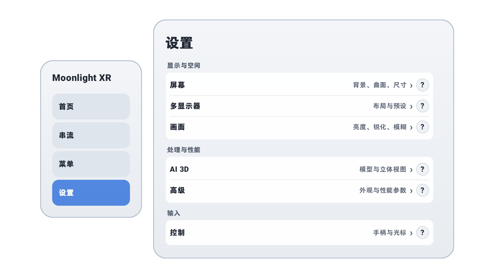
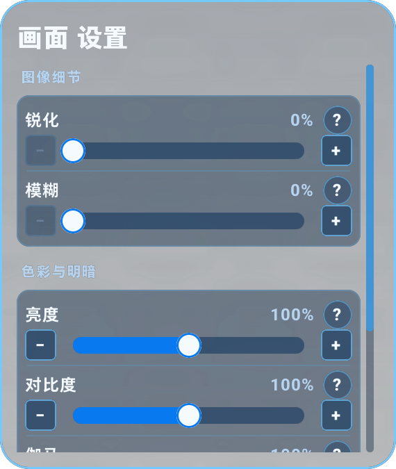
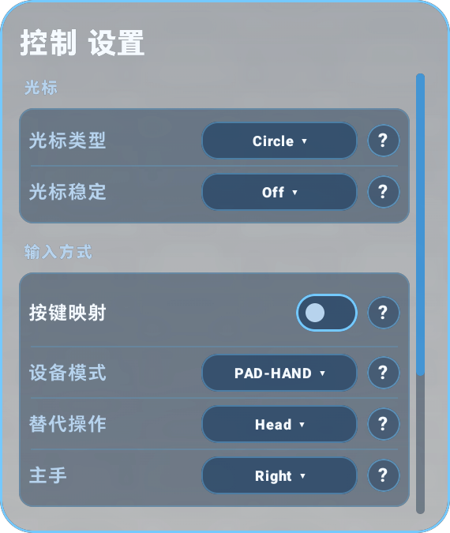
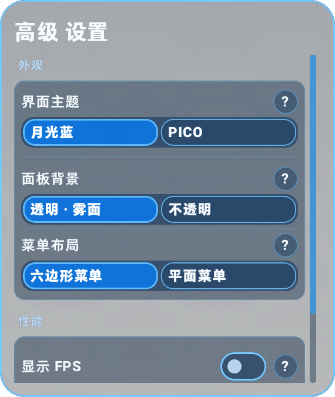
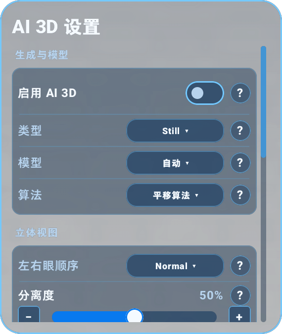
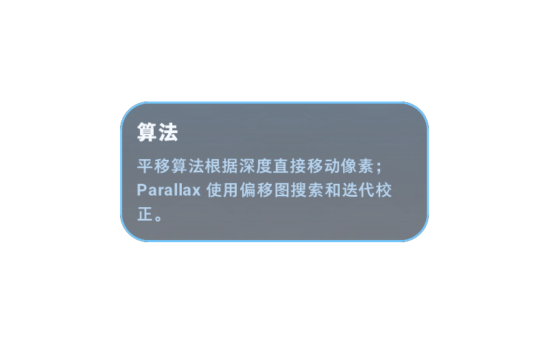

# Spatial OpenXR UI

[中文](README.md) · [Integration guide](docs/INTEGRATION.md) · [Extraction record](docs/EXTRACTION.md)

App-owned Android spatial UI extracted from MoonlightXR: Jetpack Compose controls,
themes, ray-to-pixel input, spatial geometry, asynchronous layer admission and GLES
offscreen rendering. This is not an official PICO, Google or Khronos UI SDK, and
does not depend on the private PICO Spatial UI runtime.

The independent library, Android gallery and native OpenXR example build successfully,
with 125 behavioral tests passing. Headset execution remains unverified.



This existing image is an original-project UI texture capture, not the standalone
sample or a final headset compositor capture. It illustrates grouped settings,
sidebar navigation and help affordances. Streaming and AI features named in the
image are not implemented by this UI library.

## Detailed parameter panels

These existing original-project UI texture captures illustrate component layout
and interaction styles. Each shows its captured scroll viewport. AI and image
processing behavior belongs to the original application, not this UI library.

| Picture: sliders, step buttons and values | Controls: dropdown choices and switches |
| --- | --- |
|  |  |
| **Advanced: theme, surface and menu layout** | **AI 3D: model choices and stereo view** |
|  |  |

Parameter help overlay, opened from the corresponding help affordance:



See [screenshot provenance and scope](docs/SCREENSHOTS.md). These are neither
standalone-sample captures nor final headset-compositor screenshots.

## Build and run

Install JDK 17, Android SDK platform 37, NDK 30.0.16248370 and CMake 3.22.1.
Set `JAVA_HOME` and `ANDROID_HOME`. The project pins Gradle 9.3.1, AGP 9.1.1,
Compose compiler plugin 2.3.21 and Compose BOM 2026.05.01. Android minimum is 29;
the sample targets 35; native binaries target ARM64. Windows is the tested host.

```powershell
./gradlew.bat :ui:testDebugUnitTest :ui:assembleDebug :sample:assembleDebug
adb devices
adb -s <DEVICE_ID> install -r sample/build/outputs/apk/debug/sample-debug.apk
adb -s <DEVICE_ID> shell am start -n org.spatialopenxr.sample/.GalleryActivity
```

The AAR is `ui/build/outputs/aar/ui-debug.aar`. The APK is an ordinary Android
component preview: buttons, switches, sliders and numeric input. It does not
establish an OpenXR session. On Unix use `./gradlew`; Unix hosts are untested.
For PICO use `pico-cli device list` and `pico-cli app install <APK> --device <ID>`,
with Android platform-tools on PATH.

## Reuse

Include `:ui` in the consuming project's settings and add
`implementation(project(":ui"))` to its app dependencies. Match the sample's
Compose setup. The original package `com.moonlightxr.nativeui` is retained.

```kotlin
import com.moonlightxr.nativeui.*

SpatialTheme {
    SpatialButton(label = "Open", onClick = { /* application callback */ })
}
```

The library includes buttons/chips/badges, selection and input controls, sliders,
steppers, layout/grouping, overlays, spatial window contracts, text selection,
virtual keyboard and stereo image layout. Application data remains caller-owned.
Button sizes Dense/Small/Regular/Max have minimum heights 32/40/52/60 dp.
Range sliders default to 0–1 with continuous steps; number fields default to a
step of 1. Spatial dimensions are meters, source dimensions are pixels, and
anchors are normalized 0–1 coordinates. Retained palette names describe app
contracts; `PicoNative` uses a fallback unless the caller injects system colors.

See the integration guide for producer initialization, threading, acquire/wait/
release, frame submission, ray routing, layer budgets and teardown. The GLES
bridge does not create an OpenXR instance or session. Vulkan adapters remain host-dependent reference sources; the stereo-model adapter
can be compiled optionally but has no independent headset acceptance.

## Compatibility and troubleshooting

The independent library/gallery builds have been verified on Windows. No headset
was connected during extraction; standalone XR rendering, physical controller
interaction and compositor color are unverified. Original-project PICO 4 Ultra
history is not standalone acceptance. Quest, Android XR, SteamVR, desktop XR,
Linux and macOS have not been tested. This is an Android library, not a portable
desktop Compose library.

For missing SDK errors check SDK Manager versions and `ANDROID_HOME`. For cache
lock creation errors check `GRADLE_USER_HOME` permissions. For blank spatial UI,
check Compose first frame, OES latch, swapchain copy and final submission in that
order. For incorrect ray input check matching submitted poses and hit planes,
main-thread event dispatch, and cancellation on focus loss.

## License

Self-authored extraction code uses [MIT](LICENSE), selected by the owner.
External dependencies retain their own licenses. Third-party notices are recorded in THIRD_PARTY_NOTICES.md. Unreviewed
product images, models, private SDKs and AI payloads are not included in the library.

## OpenXR sample / 空间示例

Install the sample APK as above, then use **Start OpenXR** in the gallery, or:

```powershell
adb -s <DEVICE_ID> shell am start -n org.spatialopenxr.sample/.XrActivity
adb -s <DEVICE_ID> logcat -s SpatialOpenXR MoonlightSpatialUI
```

The sample uses the OpenXR 1.0 API baseline, standard Android loader 1.1.53 and
GLES 3. It enumerates `XR_KHR_android_create_instance` and
`XR_KHR_opengl_es_enable` before enabling them; missing requirements produce an
explicit error. These are platform/graphics requirements, not a private PICO UI
SDK. The runtime must provide primary stereo and `GL_SRGB8_ALPHA8` swapchains.
The sample places a stationary 1200×800, 1.5×1.0-meter Quad at LOCAL `(0,0,-2)`.
Right-hand simple-controller aim/select drives a cyan pointer and click events;
the physical button mapping depends on the runtime. Headset acceptance is pending.
See the [static OpenXR audit](docs/OPENXR-AUDIT.md) for initialization, interaction
and teardown review and the unverified runtime checks.

Enable the optional stereo model adapter with `-PwithFilament=true`, pinned to
Google Filament 1.80.0. Supply a legally usable GLB, per-eye poses and a layer
backend; no original product models are bundled. The original Vulkan integration
sources and parameters remain under [adapters/vulkan](adapters/vulkan/README.md)
for existing Filament/Vulkan hosts. They are outside the standalone sample build.
The [component index](docs/COMPONENTS.md) links to actual definitions and parameter
defaults. [Third-party notices](THIRD_PARTY_NOTICES.md) describe resource provenance.

## 获取源码 / Clone

```powershell
git clone https://github.com/laiyangli001/spatial-openxr-ui.git
cd spatial-openxr-ui
```

See [validation](docs/VALIDATION.md) for test coverage and unverified runtime behavior.
