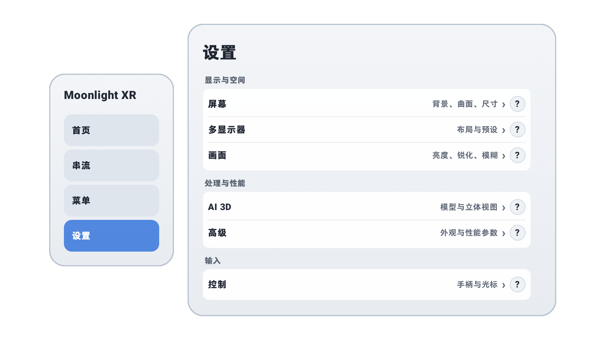

# Spatial OpenXR UI

[English](README.en.md) · [集成说明](docs/INTEGRATION.md) · [提取记录](docs/EXTRACTION.md)

从 MoonlightXR 提取的自主实现 Android 空间 UI：Jetpack Compose 控件、主题、
射线输入、空间窗口几何、图层预算和异步生命周期协调，以及 GLES 离屏纹理桥。
它不是 PICO、Google 或 Khronos 的官方 UI SDK，不依赖 PICO Spatial UI 私有运行时。

> 独立库、Android 预览和原生 OpenXR 示例已通过构建与 125 项测试。头显运行效果尚未验证。



上图来自原项目的集成 UI 纹理截图，展示侧栏、分组设置和帮助入口。它不是本仓库
独立示例或头显最终合成画面的截图。图中串流、AI 等业务不包含在 UI 库中。

## 项目结构与功能

- `ui/`：Android library，保留原包名 `com.moonlightxr.nativeui` 便于迁移。
- `sample/`：最小 Android 控件预览，可操作按钮、开关、滑块和数字输入。
- `docs/`：接入、来源、验证与限制说明。

控件包含按钮及其状态/尺寸、图标按钮、复选框、开关、芯片、徽章、链接、输入框、
滑块与步进、列表/分组、弹窗/侧窗/附着面板、日期时间选择、提示、文本选择菜单、
虚拟键盘和立体图片布局。`SpatialLayerRegistry` 处理异步图层就绪与过期回调；
`SpatialLayerBudgetHost` 在预算不足时拒绝额外图层，控件可保留同层回退。
Android Preview 不能验证这些控件在真实 OpenXR 合成器中的效果。

## 环境与构建

当前构建主机：Windows，JDK 17。固定版本：Gradle Wrapper 9.3.1、AGP 9.1.1、
Compose 编译插件 2.3.21、Compose BOM 2026.05.01、compileSdk 37、minSdk 29、
示例 targetSdk 35、NDK 30.0.16248370、CMake 3.22.1；原生目标为 ARM64。
通过 Android SDK Manager 安装上述 SDK/NDK/CMake，设置 `JAVA_HOME` 和 `ANDROID_HOME`。

在仓库根目录执行：

```powershell
./gradlew.bat :ui:testDebugUnitTest :ui:assembleDebug :sample:assembleDebug
```

库输出 `ui/build/outputs/aar/ui-debug.aar`；预览 APK 输出
`sample/build/outputs/apk/debug/sample-debug.apk`。构建所需 Maven 依赖通过网络下载。
Unix 使用 `./gradlew`；尚未在 Linux/macOS 主机验证。

```powershell
adb devices
adb -s <DEVICE_ID> install -r sample/build/outputs/apk/debug/sample-debug.apk
adb -s <DEVICE_ID> shell am start -n org.spatialopenxr.sample/.GalleryActivity
```

PICO 用户优先使用 `pico-cli device list` 和
`pico-cli app install sample/build/outputs/apk/debug/sample-debug.apk --device <DEVICE_ID>`。
确保 Android `platform-tools` 位于 PATH；不要写死其他人的设备序列号。
这仅启动普通 Android 预览，不代表 XR 会话已运行。

## 在应用中使用

复制 `ui` 模块并在 `settings.gradle.kts` 中 `include(":ui")`，在应用的 dependencies
中加入 `implementation(project(":ui"))`。使用与示例相同的 Compose 插件/BOM。

```kotlin
import com.moonlightxr.nativeui.*

SpatialTheme {
    SpatialButton(label = "打开", onClick = { /* 应用回调 */ })
}
```

所有业务值由调用方管理，控件通过回调通知改变。不要把 UI 的示例文案视为业务实现。
原始主题枚举 `MoonlightBlue`、`PicoNative` 为兼容已有调用而保留；后者在没有调用方
注入系统 palette 时使用库的回退色板，不代表读取到了 PICO 系统主题。

## 参数、兼容性和限制

`SpatialButton` 提供 Dense/Small/Regular/Max 四种尺寸，最小高度分别为
32/40/52/60 dp，Primary/Secondary 外观与选中、悬停、按下、禁用状态。
`SpatialRangeSlider` 默认范围 0–1，`steps=0` 连续变化；`SpatialNumberField`
默认步长 1、允许输入、支持范围限制。所有空间尺寸以米表示，纹理尺寸以像素表示，
锚点以 0–1 表示；两者不要混用。图层容量使用运行时报告值，必须扣除非 UI 图层。

普通 Android 预览只需 Android 29+，ARM64 构建。空间接入需要 Android OpenXR
运行时和匹配的图形扩展/会话。GLES 纹理桥本身不创建 OpenXR instance/session。
PICO 4 Ultra 的原项目有历史验证；独立提取版本当前没有头显验收结果。
Quest、Android XR、SteamVR 和桌面系统都没有独立版本实测记录。
本库不是桌面跨平台 Compose 库；Vulkan 适配保留为依赖原宿主的参考源码；立体模型适配可选编译，尚未实机验收。

若构建报 SDK 缺失，核对 `ANDROID_HOME` 和 SDK Manager 安装版本；若报告无法创建
Gradle 缓存目录，检查 `GRADLE_USER_HOME` 权限。若界面可见但 XR 射线不响应，先核对
提交姿态与命中平面是否一致、输入是否在主线程派发、失焦时是否 cancel。
空间画面空白时，区分 Compose 首帧、OES latch、swapchain 拷贝和最终图层提交四个阶段。

## 许可证

自主实现的提取代码采用 [MIT](LICENSE)。Android/Jetpack、Gradle 等外部依赖仍受各自
许可证约束。第三方清单见 THIRD_PARTY_NOTICES.md；未审查的原项目图片、模型和私有 SDK 不随库发布。

## OpenXR sample / 空间示例

Install the sample APK as above, then use **Start OpenXR** in the gallery, or:

```powershell
adb -s <DEVICE_ID> shell am start -n org.spatialopenxr.sample/.XrActivity
adb -s <DEVICE_ID> logcat -s SpatialOpenXR MoonlightSpatialUI
```

空间示例使用 OpenXR 1.0 API 基线、标准 Android loader 1.1.53、GLES 3，启动时
查询 `XR_KHR_android_create_instance` 与 `XR_KHR_opengl_es_enable`；缺失时明确报错。
这两项是 Android/GLES 宿主要求，不是 PICO 私有 UI SDK。示例要求运行时提供
立体视图配置及 `GL_SRGB8_ALPHA8` swapchain。它创建 1200×800、1.5×1.0 米的
固定 Quad，位于 LOCAL 空间 `(0,0,-2)`；右手 simple-controller aim/select 对应
青色指针和点击。具体物理按键由运行时绑定映射，不承诺每台设备都映射到 Trigger。
目前尚无独立示例头显验收；创建、交互和销毁的静态审查见 [OpenXR audit](docs/OPENXR-AUDIT.md)。

模型适配可用 `-PwithFilament=true` 启用，版本锁定为 Google Filament 1.80.0。
调用方必须提供自有合法 GLB 资源、逐眼姿态和图层后端；样例不捆绑原产品模型。
Vulkan 宿主适配保存在 [adapters/vulkan](adapters/vulkan/README.md)，保留原参数与
实现供接入现有 Filament/Vulkan 宿主参考，不参与独立示例构建。
[组件参数索引](docs/COMPONENTS.md)链接到每个组件的实际定义与默认参数。
[第三方声明](THIRD_PARTY_NOTICES.md)列出资源来源与外部依赖许可。

## 获取源码 / Clone

```powershell
git clone https://github.com/laiyangli001/spatial-openxr-ui.git
cd spatial-openxr-ui
```

See [validation](docs/VALIDATION.md) for test coverage and unverified runtime behavior.
